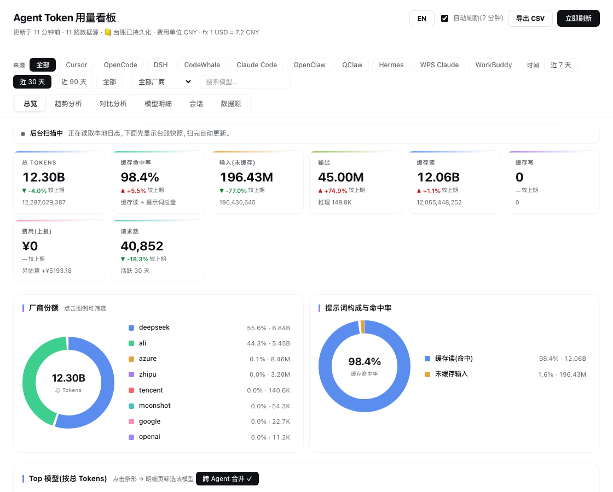
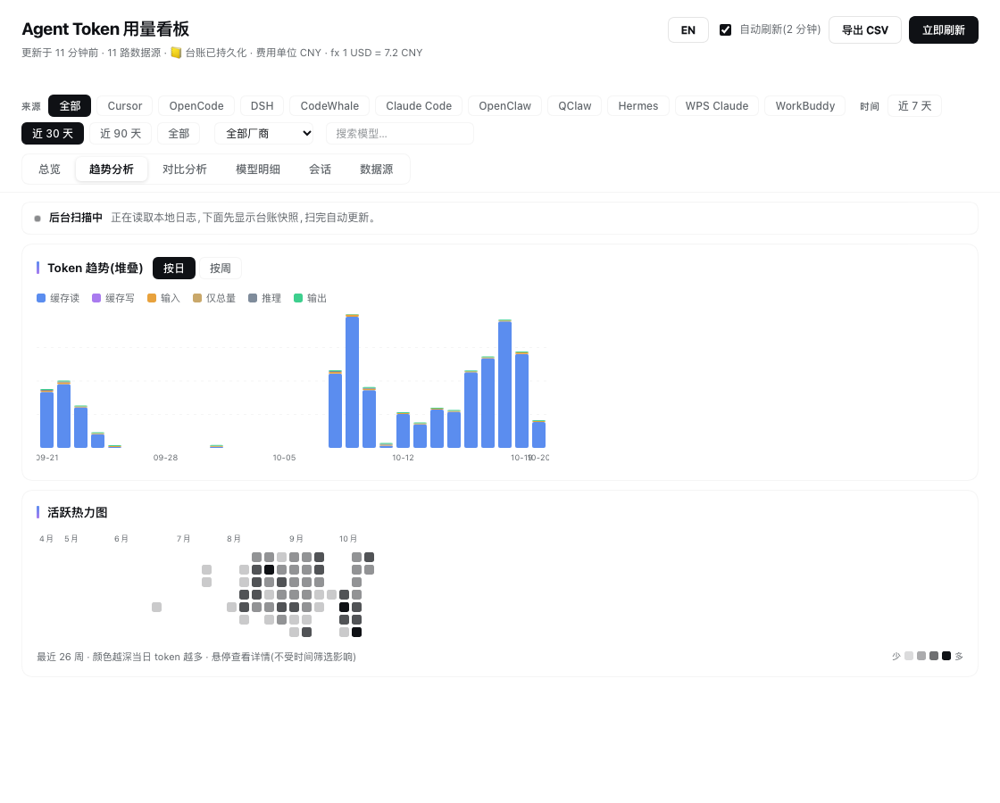
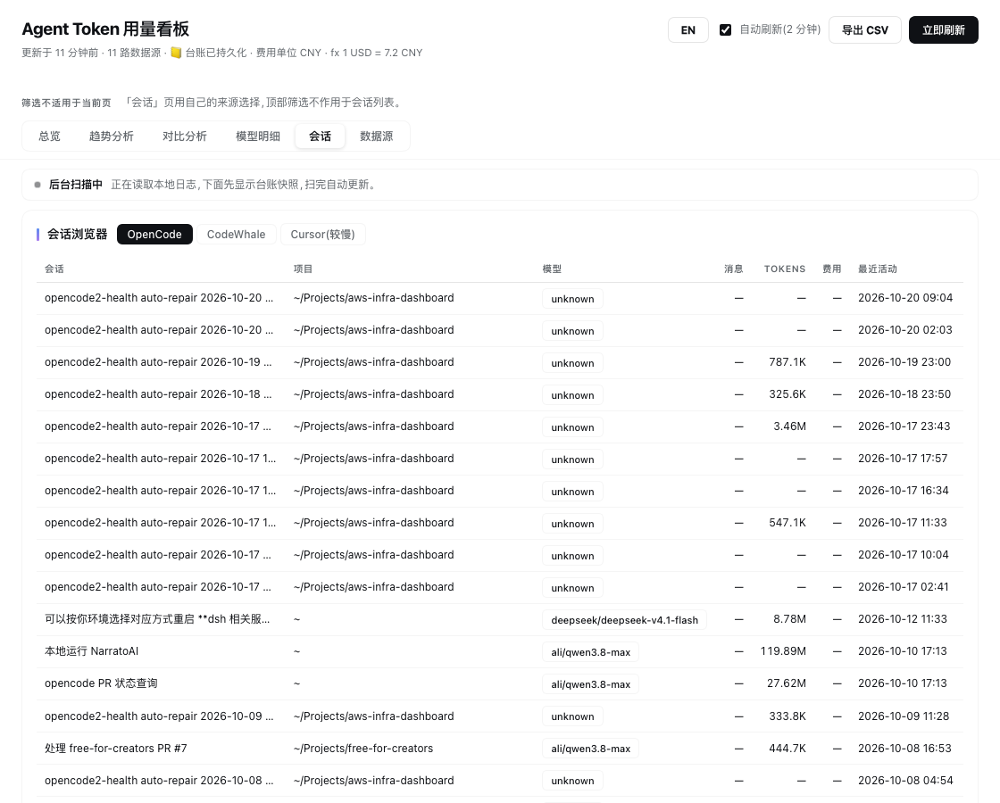

# dsh-agent-token-stats

Cross-agent local LLM token usage dashboard for DeepSeek Harness (web profile). 跨 Agent 的本地 token 用量看板。

Aggregates local conversation logs from **Claude Code, WPS Claude, OpenCode, DSH, OpenClaw, QClaw, CodeWhale, WorkBuddy, Cursor IDE and Hermes** (with **Codex CLI, Gemini CLI, Cline/Roo and Pi** parsers on standby, plus detection-only probes for Trae / Lingma / CodeGeeX / Comate / Ollama / AionUi / Copilot) into a persistent ratchet ledger, and renders a full analytics panel in the DSH web GUI sidebar.

聚合本机 10+ 个 AI 工具的对话日志到持久化台账(源日志删除后历史仍保留),在 DSH web 侧边栏提供完整分析面板。

## Install

```sh
dsh plugin --profile web add github:skyzhao1223/dsh-agent-token-stats
# npm publishing planned: dsh plugin --profile web add dsh-agent-token-stats
# then restart: dsh web
```

Requires system `sqlite3`, `jq`, and `zstd` (macOS: `brew install zstd`). Host: DSH >= 0.1.5-rc.

## Screenshots







## Features

- **Metrics**: input / output / reasoning / cache read / cache write split, cache-hit rate, request counts, reported cost vs. estimated cost (built-in reference price list, never mixed)
- **Views**: overview cards with period-over-period deltas, vendor & prompt-composition donuts (hover + click-to-filter), stacked trend chart (hover tooltip + click day drill-down), activity heatmap (click drill-down), model detail table (sort / search / expand daily sparkline / totals footer), period comparison, agent comparison, session explorer, source status with schema-drift sentinel
- **Persistence**: `~/.agent-token-stats/ledger.json` — ratchet-merged per source × model × day; rescans never double-count; history survives source-log deletion
- **Reports**: weekly / monthly Markdown download; CSV export
- **Sticky toolbar**: source chips, time range, vendor select, model search, active-filter summary with one-click clear; on the Sessions/Sources tabs it explains that filters do not apply there instead of showing dead controls
- **Loading & freshness**: real skeleton first paint, a scanning strip that says the ledger snapshot is showing, and a relative "updated N minutes ago" clock (auto-refresh is silent, so the button never flickers)
- **Keyboard**: `/` focuses model search (`Cmd/Ctrl/Alt + /` stays with the browser), `Esc` dismisses the toast → clears search → closes the day drill-down, and it only touches the model filter when this plugin's own search box has focus; tabs are a real `tablist`/`tabpanel` pair with ←/→/Home/End and `:focus-visible` rings; `prefers-reduced-motion` is honoured. Heatmap cells, bar rows, legend entries and table rows/headers stay mouse-only by design — making ~180 heat cells tabbable would be worse than leaving them out.
- **i18n**: 中文 / English toggle
- **Auto-refresh** every 2 minutes; **instant open** — the panel is answered from the host's in-memory result (or the ledger on a cold start) in milliseconds, while rescans run in the background with per-source cooldowns

## Configuration (all optional, all in `~/.agent-token-stats/`)

| File | Purpose |
| --- | --- |
| `config.json` | `{"budgets":{"dailyTokens":0,"monthlyTokens":0,"dailyCost":0,"monthlyCost":0}}` — budget alert thresholds;cost 阈值按**展示币种**解读(即 pricing.json 的 `display`) |
| `pricing.json` | 价目与展示币种,见下方「Pricing & currency」 |
| `quota.json` | `{"deepseek":{"apiKey":"sk-..."},"kimi":{"apiKey":"..."}}` — balance queries (env `DEEPSEEK_API_KEY` / `MOONSHOT_API_KEY` also work) |
| `export-*.csv` | CSV exports land here |

## Pricing & currency

`~/.agent-token-stats/pricing.json`(全部可选):

```jsonc
{
  "display": "CNY",   // 面板/报告/CSV 的展示币种;省略 = 跟 unit
  "unit": "USD",      // 你写的 rules 数字用的币种;省略 = USD
  "fx": 7.2,          // 1 USD = 7.2 display,仅在两者不同时用于换算;缺 fx 时原样展示并在面板提示
  "rules": [          // 可选:优先于内置表匹配,细分 pattern 要先写
    { "pat": "deepseek-v4.1-flash", "i": 0.28, "o": 0.42, "cr": 0.028, "cw": 0.28, "rt": 0.42 },
    { "pat": "wps-gateway/model", "i": 2, "o": 8, "cr": 0.2, "unit": "CNY" }   // 单条规则可自带币种
  ]
}
```

- 单价字段:`i` 输入(缓存未命中)、`o` 输出、`cr` 缓存读(命中)、`cw` 缓存写、`rt` 推理(省略或 ≤0 时按输出价)。
- 估算 = `(输入×i + 输出×o + 缓存读×cr + 缓存写×cw + 推理×rt) / 1e6`,再按需要换算到 `display`。
- 匹配是**小写子串 + 先命中先用**,所以 `claude-opus` 必须写在 `claude` 之前、细分模型行写在兜底行之前。
- **上报费用**(OpenCode 的 cost、CodeWhale 的 `*_usd`、Cursor 的 API 价折算)按定义是美元,展示时同样按 `fx` 换算;上报与估算永远分列、不混算。
- 未命中任何规则 = 0(不猜),面板显示 0/—。
- 内置表默认是 USD 参考价,DeepSeek 有分档行(`deepseek-v4.1-flash` / `deepseek-v4-flash` / `deepseek-reasoner` / 兜底 `deepseek`),网关转售价请用上面的 `rules` 覆盖。

## Architecture

One bundle row, two halves:
- **Host** (`lib/index.js`, injects `shell` + `webServer`): signature-based incremental scanners, ledger, pricing, and routes `GET /agent-token-stats/{data,export,sessions,report,quota}` (loopback, Origin-checked)
- **Client** (`lib/client.js`, `dsh.client` web bundle): sidebar panel + main-slot dashboard, plain `React.createElement`, no build step needed for edits

## Development

```sh
node --check lib/index.js && node --check lib/client.js
node scripts/smoke.mjs
node scripts/verify-cold-snapshot.mjs   # 秒级:冷启动首屏必须来自磁盘台账且字段同构
node scripts/verify-instant-open.mjs    # 真实 HOME:冷/热/手动刷新都必须瞬时返回(后台扫描约 2 分钟)
node scripts/verify-cooldown.mjs        # fixture HOME:冷却期内不重扫、冷却后补扫不丢数(~90s)
node scripts/verify-pricing.mjs         # 秒级:币种/fx 换算、规则币种、细分优先、推理计费、缺 fx 告警
node scripts/verify-ux.mjs              # 秒级:客户端结构级回归(骨架/筛选器适用范围/下钻/toast/键盘/a11y/token 白名单)
```

> `verify-ux.mjs` 用自带的最小 React 垫片把 Dashboard 真渲染一遍再断言结构,所以它验证的是**结构与交互**,不是视觉效果——配色、间距、真实对比度仍需在浏览器里人工确认。可用 `LTS_CLIENT=./some-copy.js node scripts/verify-ux.mjs` 指向变异副本,确认「把功能删掉断言真的会挂」。

Maintenance: edit source → `dsh plugin --profile web update dsh-agent-token-stats` → restart `dsh web`.

MIT © skyzhao1223
