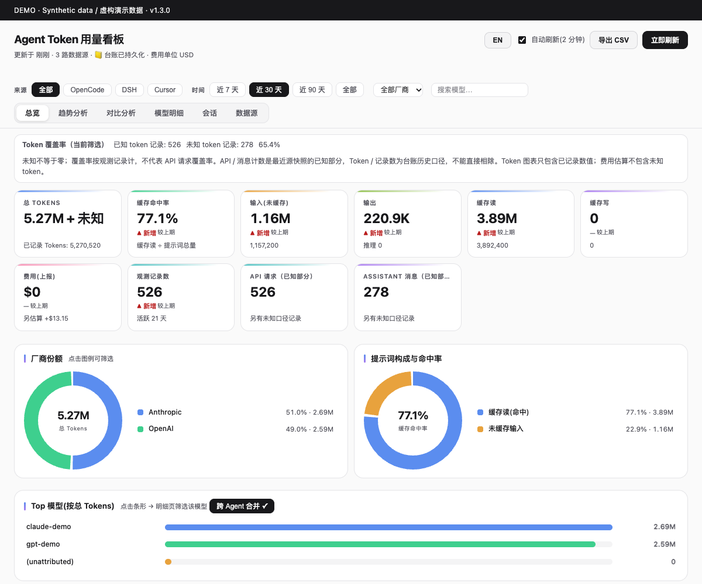
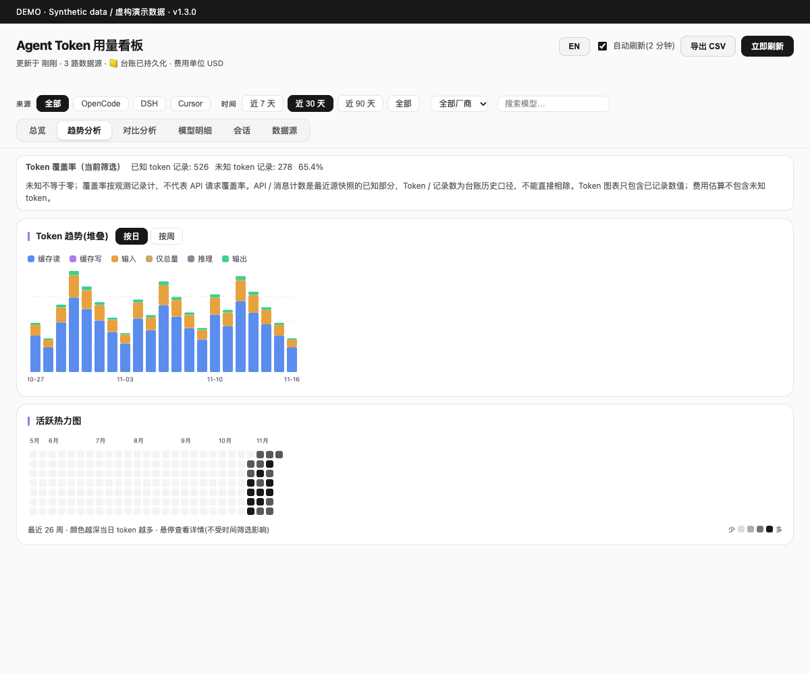
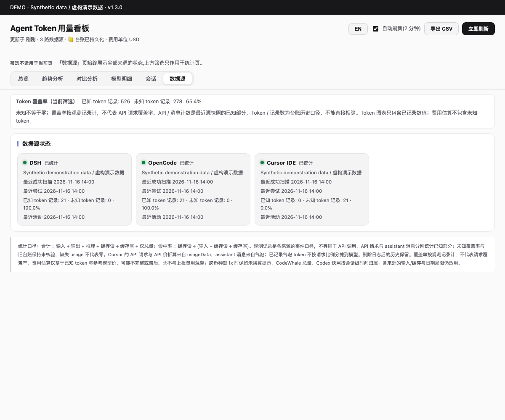

# dsh-agent-token-stats

**一个 DSH 原生侧栏看板，把多个本地 Agent 的用量放到一起看。**

Local-first, cross-agent usage analytics inside **DeepSeek Harness**: model totals, cache-hit analysis, reported/estimated costs, trends and data-quality diagnostics — without a separate dashboard service or author-side runtime telemetry.

[](https://github.com/skyzhao1223/dsh-agent-token-stats/actions/workflows/ci.yml)
[](https://github.com/skyzhao1223/dsh-agent-token-stats/releases)
[](LICENSE)

### 适合谁 / Who is it for?

- 同时使用 Claude Code、OpenCode、Cursor、DSH 等工具，想按**模型跨 Agent 合并**观察用量的人。
- 想看缓存命中率、日趋势、项目和会话差异，而不仅是一条总 token 数的人。
- 希望统计在本地运行、历史聚合保留下来，并能分辨**实测 / 未知 / 参考估算**的人。

**不是账单核对工具。** Assistant 消息不等于 API 请求；本地日志没上报 token 时显示未知；参考价格不代表订阅实际扣费。[统计边界](#reliability-and-measurement-boundaries) · [贡献指南](CONTRIBUTING.md) · [路线图](docs/ROADMAP.md) · [版本记录](CHANGELOG.md)

No billed-request or complete-coverage claim is made. Source formats vary; capabilities are listed below. For other approaches, see the neutral [community alternatives](docs/ALTERNATIVES.md) comparison.

## Install

```sh
dsh plugin --profile web add github:skyzhao1223/dsh-agent-token-stats
# npm publishing planned: dsh plugin --profile web add dsh-agent-token-stats
# then restart: dsh web
```

Requires system `sqlite3`, `jq`, and `zstd` (macOS: `brew install zstd`). Host: DSH >= 0.2.2-rc.3 (verified owner-admission API). Older hosts are not given an authentication bypass.

## Preview

The screenshots below use **synthetic demonstration data** rendered by the actual v1.3 client. They are not the author's private usage, real costs, or live-GUI acceptance evidence.

以下截图使用真实组件与**虚构演示数据**，不包含私人会话、项目路径或密钥，不代表真实账单。



<details>
<summary>趋势与数据质量 / Trends and data quality</summary>





</details>

## Source coverage / 数据源能力

| Source | Adapter | What can be observed locally |
| --- | --- | --- |
| DSH / OpenCode | Parsed | Model/provider and available token splits; cache usage and reported cost when recorded |
| Claude Code / WPS Claude | Parsed | Log usage fields; local gateways may omit token usage |
| Cursor IDE | Parsed, partial | Reported usageData when available; assistant-message counts and recorded token fields; unattributed tokens stay unattributed |
| OpenClaw / QClaw | Parsed | Available response usage in session logs |
| CodeWhale / WorkBuddy / Hermes | Parsed | Available session/response counters, with source-specific limitations |
| Codex CLI / Gemini CLI / Cline-Roo / Pi | Parsers included | Enabled when corresponding local logs exist; not all formats/platforms have been live-tested |
| Trae / Lingma / CodeGeeX / Comate / Ollama / AionUi / Copilot | Detection/probes | **Not equivalent to token support**; presence or limited counts only |

Coverage describes **parsed observations**, not completeness of the original logs. Primary development/testing platform: macOS. Linux source compatibility is partial and unverified; Windows scanning is not supported.

## Features

- **Metrics**: available input / output / reasoning / cache read / cache write splits, cache-hit rate, known API requests and assistant-message counts shown separately, reported cost vs. reference estimates (never mixed). Missing fields and unverified legacy observations are disclosed.
- **Views**: overview cards with period-over-period deltas, vendor & prompt-composition donuts (hover + click-to-filter), stacked trend chart (hover tooltip + click day drill-down), activity heatmap (click drill-down), model detail table (sort / search / expand daily sparkline / totals footer), period comparison, agent comparison, session explorer, source status with schema-drift sentinel
- **Persistence**: `~/.agent-token-stats/ledger.json` — ratchet-merged per source × model × day; identical rescans do not double-count and historical aggregates survive source-log deletion. This is not a per-message event ledger: after source log rotation, new usage below the old aggregate high-water mark may not be recognized until that mark is exceeded.
- **Reports**: weekly / monthly Markdown download; CSV export
- **Sticky toolbar**: source chips, time range, vendor select, model search, active-filter summary with one-click clear; on the Sessions/Sources tabs it explains that filters do not apply there instead of showing dead controls
- **Loading & freshness**: real skeleton first paint, a scanning strip that says the ledger snapshot is showing, and a relative "updated N minutes ago" clock (auto-refresh is silent, so the button never flickers)
- **Keyboard**: `/` focuses model search (`Cmd/Ctrl/Alt + /` stays with the browser), `Esc` dismisses the toast → clears search → closes the day drill-down, and it only touches the model filter when this plugin's own search box has focus; tabs are a real `tablist`/`tabpanel` pair with ←/→/Home/End and `:focus-visible` rings; `prefers-reduced-motion` is honoured. Heatmap cells, bar rows, legend entries and table rows/headers stay mouse-only by design — making ~180 heat cells tabbable would be worse than leaving them out.
- **i18n**: 中文 / English toggle
- **Auto-refresh** every 2 minutes; **instant open** — the panel is answered from the host's in-memory result (or the ledger on a cold start) in milliseconds, while rescans run in the background with per-source cooldowns

## Configuration (all optional, all in `~/.agent-token-stats/`)

| File | Purpose |
| --- | --- |
| `config.json` | `{"budgets":{"dailyTokens":0,"monthlyTokens":0,"dailyCost":0,"monthlyCost":0}}` — budget alert thresholds;cost 阈值按**展示币种**解读(即 pricing.json 的 `display`) |
| `pricing.json` | 价目与展示币种,见下方「Pricing & currency」 |
| `quota.json` | `{"deepseek":{"apiKey":"sk-..."},"kimi":{"apiKey":"..."}}` — balance queries (env `DEEPSEEK_API_KEY` / `MOONSHOT_API_KEY` also work) |
| `export-*.csv` | CSV exports land here |

## Pricing & currency

`~/.agent-token-stats/pricing.json`(全部可选):

```jsonc
{
  "display": "CNY",   // 面板/报告/CSV 的展示币种;省略 = 跟 unit
  "unit": "USD",      // 你写的 rules 数字用的币种;省略 = USD
  "fx": 7.2,          // 1 USD = 7.2 display,仅在两者不同时用于换算;缺 fx 时原样展示并在面板提示
  "rules": [          // 可选:优先于内置表匹配,细分 pattern 要先写
    { "pat": "deepseek-v4.1-flash", "i": 0.28, "o": 0.42, "cr": 0.028, "cw": 0.28, "rt": 0.42 },
    { "pat": "wps-gateway/model", "i": 2, "o": 8, "cr": 0.2, "unit": "CNY" }   // 单条规则可自带币种
  ]
}
```

- 单价字段:`i` 输入(缓存未命中)、`o` 输出、`cr` 缓存读(命中)、`cw` 缓存写、`rt` 推理(省略或 ≤0 时按输出价)。
- 估算 = `(输入×i + 输出×o + 缓存读×cr + 缓存写×cw + 推理×rt) / 1e6`,再按需要换算到 `display`。
- 匹配是**小写子串 + 先命中先用**,所以 `claude-opus` 必须写在 `claude` 之前、细分模型行写在兜底行之前。
- **上报费用**(OpenCode 的 cost、CodeWhale 的 `*_usd`、Cursor 的 API 价折算)按定义是美元,展示时同样按 `fx` 换算;上报与估算永远分列、不混算。
- 未命中任何规则 = 0(不猜),面板显示 0/—。
- 内置表默认是 USD 参考价,DeepSeek 有分档行(`deepseek-v4.1-flash` / `deepseek-v4-flash` / `deepseek-reasoner` / 兜底 `deepseek`),网关转售价请用上面的 `rules` 覆盖。

## Architecture

One bundle row, two halves:
- **Host** (`lib/index.js`, injects `shell`, `webServer` and `connection`): signature-based incremental scanners with bounded concurrency, locked ledger, pricing, and owner-authenticated routes `GET /agent-token-stats/{data,sessions,report,quota}` and `POST /agent-token-stats/export`. Same-origin checks supplement, rather than replace, DSH credential admission.
- **Client** (`lib/client.js`, `dsh.client` web bundle): sidebar panel + main-slot dashboard, plain `React.createElement`, no build step needed for edits

## Development

```sh
node --check lib/index.js && node --check lib/client.js
npm ci --ignore-scripts
npm test                              # isolated regressions, no operator HOME mutation
node scripts/verify-host-regression.mjs # real SQLite + multi-process locking + full-route auth
node scripts/verify-client-react.mjs    # actual ReactDOM/jsdom, six tabs + recovery boundary
python3 scripts/verify-traffic.py        # isolated raw archive/upsert/failure tests
node scripts/verify-host-ledger-diff.mjs --ledger /path/ledger.json # read-only audit
node scripts/smoke.mjs
node scripts/verify-cold-snapshot.mjs   # 秒级:冷启动首屏必须来自磁盘台账且字段同构
node scripts/verify-instant-open.mjs    # isolated fixture HOME: cold/hot/forced refresh regression
node scripts/verify-cooldown.mjs        # fixture HOME:冷却期内不重扫、冷却后补扫不丢数(~90s)
node scripts/verify-pricing.mjs         # 秒级:币种/fx 换算、规则币种、细分优先、推理计费、缺 fx 告警
node scripts/verify-ux.mjs              # 秒级:客户端结构级回归(骨架/筛选器适用范围/下钻/toast/键盘/a11y/token 白名单)
```

> `verify-ux.mjs` 用自带的最小 React 垫片把 Dashboard 真渲染一遍再断言结构,所以它验证的是**结构与交互**,不是视觉效果——配色、间距、真实对比度仍需在浏览器里人工确认。可用 `LTS_CLIENT=./some-copy.js node scripts/verify-ux.mjs` 指向变异副本,确认「把功能删掉断言真的会挂」。

## Reliability and measurement boundaries

- **Messages are not API requests.** An assistant bubble can be a tool event, reasoning chunk or streamed part. Cursor fallback counts are assistant messages unless a stable request ID proves distinct requests. Local missing token values are unknown, not measured zero. No claim that usage necessarily moved to a cloud service is made from empty local fields alone.
- **Coverage is part of the result.** A numeric token subtotal only includes available fields. Counts from heterogeneous sources are not a comparable billed-request total. Reported cost and reference estimates are separate; estimates are not subscription invoices.
- **History is preserved.** Reliability upgrades do not rewrite the existing ledger in place to change historical count semantics. Use the read-only audit/difference tool first; legacy totals with uncertain semantics remain explicitly disclosed.
- **GitHub traffic is not installs.** The author-side `scripts/traffic-snapshot.py` archives three validated GitHub responses (repository, clones, views), their daily series and UTC timestamps. Same-day samples replace rather than duplicate CSV rows; failed responses append nothing. Rolling windows overlap and must never be added together or divided into daily installation counts. This script is not executed by the plugin and introduces no runtime telemetry.
- **Platform support:** source scanners are currently macOS-oriented. Unsupported platforms and missing executables are disclosed by diagnostics; a green JS test does not establish Windows/Linux source compatibility.
- **Ledger locking:** commits acquire `.ledger.lock` and reload disk state before merging. Backups rotate by the backup timestamp, not the frequently updated primary file. Invalid primaries fall back to a validated backup and preserve corruption evidence. Dead/orphan locks are not automatically stolen (to avoid deleting another writer's newly acquired lock); a lock timeout requires checking the recorded owner/PID and confirming no writer is alive before manual recovery. Failure to recover a ledger is reported rather than replacing it with an empty one.

## Safe publication

The npm package has **not yet been published**. Use the GitHub installation above until availability is verified. Downloads on npm, when available, count download events, not installed users.

The manual `publish.yml` workflow is designed for [npm Trusted Publishing](https://docs.npmjs.com/trusted-publishers/): bind the exact GitHub owner/repository/workflow and `npm-release` environment in npm, and protect that GitHub environment with approval. First publication/package provisioning may still need the owner's local interactive `npm publish` browser/passkey authentication. No reusable publish token is stored in this project. **Revoke any token previously pasted into chat; do not share passkeys, tokens, OTPs or recovery codes with an agent.** Workflow dispatch alone does not make a package available until npm trust is configured and publication succeeds.

## Applying updates

Use the running Harness plugin manager to update an installed bundle. Whether a change is applied live is determined by its installation result; do not assume a watcher is active. UI updates need a browser refresh unless an active rebuild/HMR chain is verified. Host updates must be reloaded through the supported manager path or, when it reports restart required, on the next restart. Editing a `link:` source file alone does not prove running Host code changed.

MIT © skyzhao1223
